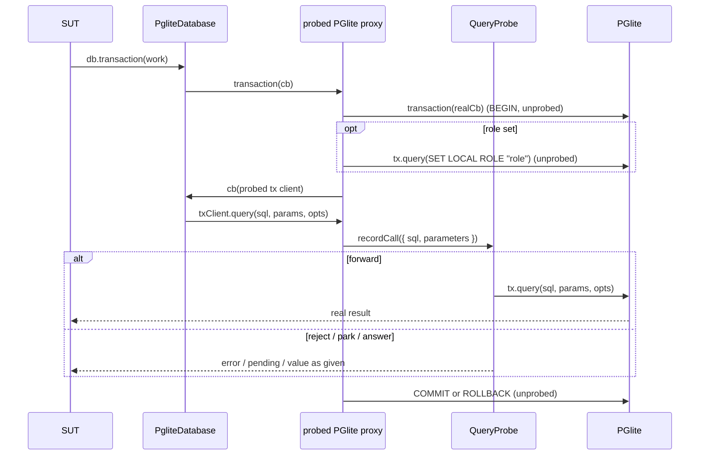

# P14 pg-drizzle: probed Drizzle over PGlite

Applies to: docs/internal/spec/pg-drizzle.md (new capability file, created on fold)
Also modifies: docs/internal/spec/core-public-api.md,
docs/internal/spec/docs-truth.md, docs/internal/spec/ci-gate.md
Packet: docs/internal/packets/P14-pg-drizzle.md
Ticket: none

**Semver.** Adds a new published package, `@hochgi/test-kit-pg-drizzle`,
starting at `2.0.0` (the family major). No existing package's public surface
changes; no existing package version bumps are required by this delta.

The adapter is a **backed** adapter in the SQL family. The SUT gets a real
`PgliteDatabase<TSchema>` from `drizzle-orm/pglite`. The adapter intercepts
below Drizzle, at the PGlite client: every statement Drizzle sends to
`query()` (on the instance, or on the transaction client handed to a
`transaction()` callback) is a **call** of shape `QueryCall`
(`{ sql, parameters }`) routed through the shared
`createProbedSqlAdapter` probe. Pooling, retries and transaction
orchestration stay in the component.

## ADDED Requirements

### Requirement: Package and factory shape
The repository SHALL contain a published package
`@hochgi/test-kit-pg-drizzle` at `packages/pg-drizzle/`, on major `2`, that
exports `createProbedDrizzleAdapter`, the types
`CreateProbedDrizzleAdapterOptions<TSchema>` and
`ProbedDrizzleAdapter<TSchema>`, and re-exports `QueryCall`,
`QueryPendingCall`, `QueryProbe` and `SqlDriver` from
`@hochgi/test-kit-sql` (as `pg-kysely` does).

`createProbedDrizzleAdapter(options)` SHALL accept
`{ harness, schema?, bootstrap, role?, extensions?, defaultTimeout? }` where
`bootstrap: (db: PgliteDatabase<TSchema>) => Promise<void>` and resolve to a
`ProbedAdapterWithLifecycle<PgliteDatabase<TSchema>, QueryProbe>` that also
carries `seed(table, rows)`, `pglite: PgliteHandle` and
`notifications: PgliteHandle['notifications']`. When `schema` is given, the
`adapter` SHALL support Drizzle's relational `db.query.<table>` API for it.

`drizzle-orm` SHALL be a peer dependency ranged `>=0.30.6 <1`, and
`@electric-sql/pglite` a peer dependency ranged `^0.3.2`. `@hochgi/test-kit`
SHALL be a peer at `^2.0.0`; `@hochgi/test-kit-sql` and
`@hochgi/test-kit-pglite-driver` SHALL be `dependencies` at `^2.0.0`.

#### Scenario: factory resolves to the documented handle
- **WHEN** `createProbedDrizzleAdapter({ harness: rig, bootstrap })` is awaited
- **THEN** the result has `adapter`, `probe` (with `sql`, `filter`, `calls`,
  `expect`), `seed`, `reset`, `close`, `pglite` and `notifications`, and
  `notifications` is the same object as `pglite.notifications`

### Requirement: Default rule forwards every application statement
The adapter SHALL install `probe.always().forward()` as its default rule, so
with no user rules every application statement executes against PGlite and
the SUT receives real results. Every Drizzle entry point SHALL produce a
call: the query builder (`select` / `insert` / `update` / `delete`), the
relational API (`db.query.*`), raw `db.execute(sql…)`, prepared queries
(`.prepare().execute()`), and every statement run inside `db.transaction()`.
Each call's `sql` SHALL be the statement text Drizzle sent and `parameters`
the bound values in order.

#### Scenario: forward returns real rows
- **WHEN** a row is seeded and the SUT selects it through the query builder with no rules installed
- **THEN** the SUT receives the seeded row, and `probe.calls` holds one call whose `sql` is the select statement and whose `parameters` are the bound values

#### Scenario: relational query is probed
- **WHEN** the adapter is created with `schema` and the SUT runs `db.query.<table>.findMany()`
- **THEN** the SUT receives the real rows and `probe.calls` contains the relational select

#### Scenario: raw execute is probed
- **WHEN** the SUT runs `db.execute(sql\`select 1 as one\`)`
- **THEN** the SUT receives `rows` `[{ one: 1 }]` and `probe.calls` contains `select 1 as one`

#### Scenario: prepared query is probed on each execution
- **WHEN** the SUT prepares a parameterised select and executes it twice with different placeholder values
- **THEN** `probe.calls` holds two calls with the same `sql` and each execution's `parameters`

#### Scenario: statements inside a transaction are probed
- **WHEN** the SUT runs an insert and a select inside `db.transaction(async (tx) => …)`
- **THEN** both statements appear in `probe.calls` in order, and the transaction commits

### Requirement: Other PGlite members pass through unprobed
Members of the PGlite client other than `query()` and `transaction()`
(reached via the adapter's `$client`) SHALL behave as on the real PGlite
instance and SHALL NOT produce calls. A probed `query()` called without a
parameter array SHALL record `parameters` as `[]`.

#### Scenario: $client members behave like the real instance
- **WHEN** the test reads the adapter's `$client` and calls `exec('select 3 as three')`, reads `closed`, and checks `constructor`
- **THEN** `exec` resolves with the real result, `closed` is `false`, `constructor` is `PGlite`, and `probe.calls` is empty

#### Scenario: query without parameters records an empty parameter list
- **WHEN** the test calls `$client.query('select 2 as two')` with no parameters
- **THEN** it resolves with `rows` `[{ two: 2 }]` and `probe.calls` holds `{ sql: 'select 2 as two', parameters: [] }`

### Requirement: Transaction control statements are not calls; savepoints are
`BEGIN`, `COMMIT` and `ROLLBACK` issued by PGlite's `transaction()` SHALL NOT
appear as calls (family consistency with pg-kysely, pg-knex, pg-sequelize).
A nested `tx.transaction()` SHALL produce probed calls `savepoint sp<n>` and
`release savepoint sp<n>` (or `rollback to savepoint sp<n>` when the nested
callback throws), so a catch-all rule matches them.

#### Scenario: BEGIN and COMMIT never appear
- **WHEN** the SUT commits a transaction that runs one select
- **THEN** no call in `probe.calls` matches `/^\s*(begin|commit|rollback)\b/i`

#### Scenario: nested transaction yields savepoint calls
- **WHEN** the SUT runs one select inside `tx.transaction()` nested in `db.transaction()`
- **THEN** `probe.calls` is, in order, `savepoint sp1`, the select, `release savepoint sp1`

#### Scenario: nested transaction that throws rolls back to its savepoint
- **WHEN** inside `db.transaction()` the SUT inserts row A, then a nested `tx.transaction()` inserts row B and throws, and the outer callback catches that error and commits
- **THEN** `probe.calls` contains `rollback to savepoint sp1` (and no `release savepoint sp1`), and afterwards row A is visible and row B is not

### Requirement: Probe settlement reaches the SUT
A call matched by a rule or captured by `expect.intercept` SHALL be settled
as the core settlement verbs define: `reject(err)` rejects the SUT's Drizzle
promise with `err` without touching PGlite; `park()` (or a captured, not yet
settled call) leaves the SUT's promise pending until the test settles it;
`forward()` runs the statement on PGlite; `answer(value)` resolves PGlite's
`query()` with `value` exactly as given — the adapter performs no row-shape
conversion, so Drizzle post-processes `value` as if PGlite had returned it.
`answer()` is inherited, not a featured path for this backed adapter.

"Rejects with `err`" throughout this delta means: the SUT's Drizzle promise
rejects with `err`, or with an error whose `cause` chain contains `err`.
drizzle-orm ≥ 0.44 wraps every driver error in `DrizzleQueryError` (original
as `cause`); the adapter does not unwrap it. Errors the SUT raises itself
(e.g. its own timeout) are not wrapped.

#### Scenario: always().reject rejects the SUT's query
- **WHEN** `probe.sql(/insert into/).always().reject(new Error('disk full'))` is installed and the SUT inserts a row
- **THEN** the SUT's promise rejects with `disk full`, and a subsequent unprobed count of that table is 0

#### Scenario: once().reject is one-shot
- **WHEN** `probe.once().reject(new Error('transient'))` is installed and the SUT runs the same select twice
- **THEN** the first rejects with `transient` and the second returns real rows

#### Scenario: a captured query stays pending until released
- **WHEN** the SUT starts a select, the test captures it with `probe.expect.intercept({ within })`, and the test then calls `forward()`
- **THEN** the SUT's promise is unsettled before `forward()` and resolves with real rows after it

#### Scenario: a parked query lets the SUT's own timeout fire
- **WHEN** `probe.sql(/select/).once().park()` is installed and the SUT races its select against its own timeout
- **THEN** the SUT observes its timeout error, and the parked call is in `probe.calls`

#### Scenario: answer passes through unchanged
- **WHEN** `probe.once().answer({ rows: [{ one: 42 }], fields: [], affectedRows: 0 })` is installed and the SUT runs `db.execute(sql\`select 1 as one\`)`
- **THEN** the SUT receives `rows` `[{ one: 42 }]`

### Requirement: Out-of-order release within one PGlite session scope
Concurrent calls issued in the same transaction, or concurrently outside any
transaction, SHALL be independently settleable: releasing them in reverse
order SHALL give each caller its own result.

#### Scenario: two concurrent queries released in reverse order
- **WHEN** the SUT issues two different selects concurrently (outside a transaction), the test intercepts both, and forwards the second before the first
- **THEN** each SUT promise resolves with the rows of its own statement, and the second resolves before the first

#### Scenario: two concurrent queries inside one transaction released in reverse order
- **WHEN** inside one `db.transaction()` the SUT issues two selects concurrently and the test intercepts both and forwards the second before the first
- **THEN** each resolves with its own rows and the transaction commits

### Requirement: Rejection inside a transaction rolls it back
When a call inside `db.transaction()` is rejected by the probe and the SUT
lets the error propagate out of the callback, the transaction SHALL roll back
and none of its earlier writes SHALL be visible afterwards.

#### Scenario: rejected second write rolls back the first
- **WHEN** the SUT inserts row A then row B in one transaction and the probe rejects the insert of B
- **THEN** `db.transaction()` rejects with the probe's error and a subsequent select sees neither A nor B

### Requirement: Cross-transaction serialisation is a documented limitation
PGlite runs one transaction at a time. While any statement of transaction A
is pending in the probe (captured or parked), a second transaction B SHALL
NOT start — its statements are not recorded as calls until A ends — and a
plain (non-transaction) statement SHALL be recorded as a call but SHALL NOT
resolve until A ends. Once A settles, B and the plain statement proceed. The
package README SHALL state this limitation and that cross-transaction race
tests need a multi-connection backing (not provided).

When a SUT's own timeout fires *inside* the transaction callback (so the
callback throws), the transaction SHALL roll back and release PGlite, and the
next request SHALL proceed even though the timed-out call is still pending in
the probe.

#### Scenario: transaction B waits for parked transaction A
- **WHEN** a select in transaction A is captured, and the SUT then starts transaction B and a plain select
- **THEN** B's statements are absent from `probe.calls`, the plain select is present but unresolved, and after the test forwards A's select, A, B and the plain select all resolve

#### Scenario: a timeout thrown inside the transaction frees PGlite
- **WHEN** a select inside a transaction is parked and the SUT's timeout rejects inside the transaction callback
- **THEN** `db.transaction()` rejects with the timeout error, and a following SUT query resolves with real rows

### Requirement: Optional application role
When `role` is set, every application statement SHALL execute as that role:
the adapter SHALL issue `SET LOCAL ROLE "<role>"` (the role as a quoted
identifier) as the first statement of every application transaction, and
SHALL wrap each non-transaction application statement in a short PGlite
transaction that does the same. That `SET LOCAL ROLE` statement and the
wrapping `BEGIN`/`COMMIT` SHALL NOT appear as calls. `bootstrap`, `seed` and
`reset` SHALL keep running as PGlite's owner role. When `role` is unset no
role statement is issued and plain statements are NOT wrapped in a
transaction.

#### Scenario: current_user is the role inside and outside transactions
- **WHEN** `role: 'app_rt'` is set and the SUT selects `current_user` both via `db.execute` and inside `db.transaction()`
- **THEN** both return `app_rt`, and no call in `probe.calls` contains `SET LOCAL ROLE`

#### Scenario: without role, plain statements run outside a transaction
- **WHEN** `role` is unset and the SUT runs `db.execute(sql\`vacuum <table>\`)`
- **THEN** it resolves (Postgres refuses `VACUUM` only inside a transaction block)

#### Scenario: RLS filters reads and rejects cross-tenant writes
- **WHEN** bootstrap creates role `app_rt`, a table with RLS and a tenant policy on `current_setting('app.customer_id', true)`, two tenants are seeded, and the SUT sets `app.customer_id` to tenant 1 inside a transaction
- **THEN** a select returns only tenant 1's rows, and an insert of a tenant-2 row rejects with a row-level security error

#### Scenario: seed and reset still run as owner
- **WHEN** `role: 'app_rt'` is set (with `app_rt` lacking TRUNCATE/DROP rights) and the test seeds, then `rig.reset()`s
- **THEN** both succeed and the table is empty and re-bootstrapped afterwards

### Requirement: Maintenance path is unprobed
`bootstrap` SHALL run on a Drizzle instance over the same PGlite that
bypasses the probe. `seed(table, rows)` SHALL take a Drizzle `PgTable` and
rows typed `table.$inferInsert`, insert them through that maintenance
instance, and resolve without inserting when `rows` is empty. Neither SHALL
produce calls.

#### Scenario: bootstrap and seed produce no calls
- **WHEN** the adapter is created (bootstrap creates a table) and the test seeds two rows
- **THEN** `probe.calls` is empty, and an application select then returns both rows

#### Scenario: seeding no rows is a no-op
- **WHEN** `seed(table, [])` is awaited
- **THEN** it resolves and `probe.calls` is empty

### Requirement: Lifecycle
`reset()` SHALL drop all user tables in the `public` schema then re-run
`bootstrap`. `close()` SHALL dispose the PGlite handle. When `bootstrap`
throws during construction, the factory SHALL dispose the handle and reject
with the bootstrap error.

#### Scenario: reset empties tables and re-bootstraps
- **WHEN** rows are seeded and `rig.reset()` is awaited
- **THEN** the table exists and an application select returns no rows

#### Scenario: close releases PGlite
- **WHEN** `close()` is awaited
- **THEN** `pglite.pglite.closed` is `true`

#### Scenario: bootstrap failure disposes and rethrows
- **WHEN** `bootstrap` captures the PGlite instance it is handed (`db.$client`) and then rejects with `Error('boom')`
- **THEN** `createProbedDrizzleAdapter` rejects with that error, and the captured instance's `closed` is `true`

### Requirement: Notifications on the same instance
`notifications` SHALL deliver `pg_notify` issued through the probed Drizzle
after commit (same PGlite instance), as in pg-kysely.

#### Scenario: NOTIFY through the adapter reaches a listener
- **WHEN** the test listens on `work_ready` and the SUT runs `select pg_notify('work_ready', 'x')`
- **THEN** the listener receives `x`

### Requirement: RLS consumer acceptance example
The repository SHALL contain a private workspace example
`examples/pg-drizzle-rls` that consumes `@hochgi/test-kit-pg-drizzle` the way
the first consumer does: bootstrap creates role `app_rt`, a `clients` table
whose `customer_id` defaults from `current_setting('app.customer_id', true)`,
RLS with a tenant policy, and grants to `app_rt`; a service
`forTenant(id).transaction(work)` runs
`select set_config('app.customer_id', <id>, true)` then `work(tx)` inside one
transaction, with a per-request timeout enforced inside the transaction.
The adapter is created with `role: 'app_rt'`. The example's tests run on the
root `npm test` path.

#### Scenario: tenant isolation with two seeded tenants
- **WHEN** clients for tenants 1 and 2 are seeded and tenant 1 lists clients
- **THEN** only tenant 1's clients are returned

#### Scenario: probe-rejected write rolls back the request
- **WHEN** a request inserts two clients and the probe rejects the second insert
- **THEN** the request fails with the probe's error and tenant 1 sees neither new client

#### Scenario: probe-hung read times out and the next request works
- **WHEN** the probe parks one select and a request times out on it
- **THEN** the request fails with its timeout error, and the next request returns real rows

#### Scenario: set_config is seen before the repository query
- **WHEN** a request lists clients
- **THEN** in `probe.calls` the `set_config` call precedes the `clients` select

### Requirement: Workspace wiring for pg-drizzle
`packages/pg-drizzle` and `examples/pg-drizzle-rls` SHALL be listed in root
`vitest.config.ts` `test.projects` and in root `tsconfig.json` references.
`packages/pg-drizzle/README.md` SHALL document install, quick start, the
handle, `role`, savepoint visibility, `answer()` pass-through and the
cross-transaction limitation. It SHALL also state two seam limits: only
`query()` and `transaction()` are probed, so other PGlite members reached via
`db.$client` (e.g. `exec`, `sql`) bypass both the probe and `role`; and with
`role` set each plain statement runs in its own short transaction, so
statements Postgres refuses inside a transaction block (`VACUUM`,
`CREATE INDEX CONCURRENTLY`, a raw `BEGIN`) fail.

#### Scenario: projects and references list the new workspaces
- **WHEN** root `vitest.config.ts` and `tsconfig.json` are read
- **THEN** both name `packages/pg-drizzle` and `examples/pg-drizzle-rls`

## MODIFIED Requirements

### Requirement: Every workspace package is on major version 2
(core-public-api.md) All 14 workspace packages under `packages/` SHALL declare
a version on major `2`. Otherwise unchanged.

### Requirement: Core is a peer dependency of every sibling that needs it
(core-public-api.md) The consumer list becomes the 12 packages `bull`,
`kafka`, `mock`, `mysql`, `pg-drizzle`, `pg-knex`, `pg-kysely`,
`pg-sequelize`, `redis`, `s3`, `sql`, `sqs`. `examples/pg-drizzle-rls`, like
`examples/grpc-client`, is a private consumer and keeps `@hochgi/test-kit` in
`dependencies` at `^2.0.0`. Otherwise unchanged.

### Requirement: Every published package is publicly publishable
(ci-gate.md) "thirteen" becomes "fourteen"; `pg-drizzle` meets the same
license / `publishConfig` / `files` / `LICENSE` rules. Otherwise unchanged.

### Requirement: Package inventories list every published workspace package
(docs-truth.md) The list becomes fourteen packages, adding
`@hochgi/test-kit-pg-drizzle`: root `README.md` Packages table,
`docs/architecture.md` package graph and domain-layer list, and
`docs/api-surface.md` Package Names. Otherwise unchanged.

### Requirement: architecture repository layout matches the tree
(docs-truth.md) The layout SHALL include all fourteen package directories,
including `pg-drizzle`. Otherwise unchanged.

### Requirement: pg factory types in api-surface match source
(docs-truth.md) Adds `packages/pg-drizzle/src/factory.ts`:
`docs/api-surface.md` SHALL document `CreateProbedDrizzleAdapterOptions` and
`ProbedDrizzleAdapter` as declared there. Otherwise unchanged.

### Requirement: tech-design build section matches the manifests
(docs-truth.md) tsconfig references include all fourteen packages plus
`examples/grpc-client` and `examples/pg-drizzle-rls`. Otherwise unchanged.

`RELEASING.md`'s trusted-publisher loop SHALL include `test-kit-pg-drizzle`
(prose only; no test).

## REMOVED Requirements

n/a

## Flow

## Decisions (rung recorded)

| Decision | Outcome | Rung |
| --- | --- | --- |
| Interception seam | Proxy over the PGlite instance: `query()` and the tx client's `query()` probed; `transaction()` wraps; every other member passes through | Packet (verified against drizzle-orm 0.45.4 `pglite/session.js`) |
| BEGIN/COMMIT probed? | No; savepoints are (they are ordinary `tx.execute` statements) | Sibling precedent + packet |
| Default rule | `always().forward()` | Sibling precedent (pg-kysely) |
| `answer()` row shape | Passed through unchanged; not featured | Packet (settled with user) |
| Role statement | `SET LOCAL ROLE "<role>"`, quoted identifier, unprobed; non-tx statements wrapped in a short transaction | Packet; quoting from pglite-driver precedent (`truncateAllUserTables` quotes identifiers) |
| Cross-transaction ordering | Documented limitation (scenario + README), no workaround | Packet |
| Parked call vs. SUT timeout | A timeout thrown inside the tx callback frees PGlite; outside it, the tx holds the lock until the call is settled (README) | Source (PGlite 0.3.16 experiment) |
| `drizzle-orm` peer range | `>=0.30.6 <1`: 0.30.6 is the first release with `drizzle-orm/pglite`; `session.js` query/transaction/savepoint shape is identical 0.30.6 → 0.45.4; CI exercises only the devDependency (0.45.x) | Packet rule + source (published tarballs inspected) |
| `@electric-sql/pglite` | Peer `^0.3.2` (packet), also a devDependency; `pglite-driver` already depends on it | Packet + sibling precedent |
| `reset()` semantics | Drop user tables in `public` then re-run `bootstrap` (pg-kysely); `README` says "drops" | Sibling precedent (source wins over packet's "truncates" wording) |
| Driver-error wrapping | Not unwrapped; drizzle ≥ 0.44 surfaces probe rejections and Postgres errors as `DrizzleQueryError` with the original as `cause` | Source (drizzle-orm 0.45.4, observed in phase 2) |
| Unprobed `$client` members; role wraps plain statements | Documented in README, not routed (Drizzle itself only calls `query`/`transaction`) | Packet ("every other member passes through") + reviewer finding |
| Initial version | `2.0.0` | core-public-api.md (major 2) |

Doc/code discrepancy noted: the packet says `reset()` "truncates"; the shared
`truncateAllUserTables()` actually `DROP TABLE … CASCADE`s every public user
table. The code wins, and bootstrap must therefore be re-runnable from empty.

## Out of scope (deferred)

| Item | Consequence of deferring |
| --- | --- |
| Other Drizzle drivers (`postgres-js`, `node-postgres`) | Consumers must build their Drizzle on `PgliteDatabase` in tests; sensi-sor-api must widen its DB type first |
| Multi-connection / cross-transaction concurrency backing | Cross-request race tests are not expressible; separate Testcontainers packet if needed |
| Workarounds for PGlite's transaction lock | A parked call in one transaction blocks others (documented) |
| Probing BEGIN/COMMIT | Commit failures cannot be injected |
| Streaming / cursors, migration helpers, Prisma | Not available |
| Row-shape conversion for `answer()` | Answered values must already be PGlite `Results` in the shape Drizzle expects |

## Acceptance mapping

1. `packages/pg-drizzle/test/integration/*.test.ts` — one test per package scenario above, asserting at the Drizzle `adapter` promise, `probe.calls`, and unprobed reads via `pglite.maintenance`.
2. `examples/pg-drizzle-rls/test/*.test.ts` — the four example scenarios, asserting at the service's request promise and `probe.calls`.
3. `packages/core/test/unit/package-graph.test.ts` — 14 package dirs; 12 core consumers including `pg-drizzle`.
4. `test/ci-gate/ci-gate.test.ts` — `pg-drizzle` in the published-packages list (license / publishConfig / LICENSE).
5. `test/docs-truth/docs-truth.test.ts` — fourteen packages in README / architecture / api-surface inventories; drizzle factory types in api-surface; tsconfig references.
6. Root `vitest.config.ts` and `tsconfig.json` name both new workspaces (asserted by the workspace-wiring scenario; may live in `test/ci-gate`).
